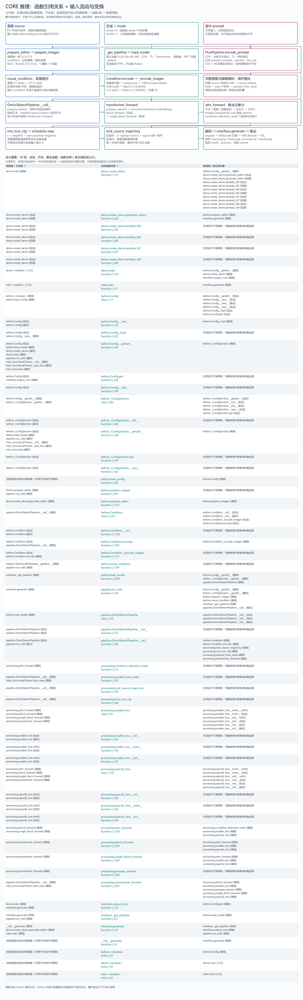

# Core：推理端

## 模块

- before.py：配置、输入处理、背景条件图、VAE 条件编码、模型加载。
- pipeline.py：run_edit 和 OminiSketchPipeline，承担从输入到生成结果的完整路径。
- processing.py：联合注意力、LoRA 路由、条件门控、掩码打包、CFG 和区域外轨迹保护；部分函数由训练共用。
- interface.py：外部接口 generate，复用模型、串行执行、保存并返回结果。
- __init__.py：公共 generate 包装入口；demo.py 和 infer.py 直接调用 interface.generate。

## 输入流动

```text
demo：editor/background + 绘制图层或上传区域 + prompt
  -> prepare_editor（mode=0 读取 alpha；mode=1 使用上传区域图）
  -> prepare_images
infer：source + mask + prompt
  -> interface.generate -> run_edit -> prepare_images
```

prepare_images 输出五项：source（512 RGB）、condition（白色编辑/黑色保留的图）、field（二维 float32，1 编辑/0 保留）、preview（黑色编辑/白色保留的图）、去空白后的 prompt。condition 与 field 表达同一份区域信息；这里没有模型编码。

run_edit 获取缓存管道，调用 visual_condition：保留原图背景，编辑区置为灰色。该 masked-source 图经 Condition.encode 使用 FLUX VAE 编码为条件 tokens，参与联合注意力。黑白 condition 不直接送入 VAE，主要在当前调用中提供尺寸。

完整原图另经 VAE 编码为 source tokens，field 经 packed_hole_mask 变成潜空间区域权重。每一步预测速度、执行真正 CFG、调度器更新后，lock_source_trajectory 保护区域外的原图加噪轨迹。最后直接 VAE 解码，不做 RGB 拼接或轮廓缩放。

文本由 FLUX 的 CLIP/T5 编码。原图背景不通过自动总结文字或 Redux token 提供，而是通过 masked-source 条件和完整原图轨迹保护提供。

## 核心调用

```text
generate -> run_edit -> OminiSketchPipeline.__call__
  -> transformer_forward -> block_forward / single_block_forward
  -> attn_forward -> 条件门控与 LoRA 路由 -> Torch SDPA
```

首次生成通过 _get_pipeline -> load_model 创建 OminiSketchPipeline，后续复用。模型只按配置加载；没有独立 adapter 完整性检查脚本。输入合法性检查仍保留。

## 完整图



上半部分展示数据变换，下半部分逐项展示当前 demo/infer/core 的全部函数、类和匿名回调。按原始尺寸放大查看。箭头从调用者指向被调用者，包含、继承、回调、隐式调用和属性访问有标签；外部库按功能合并，不递归展开全部内部函数。

保存输出：source.png、mask.png、prompt.txt、result.png；参数嵌入结果 PNG。运行前提和命令见项目根 README。
