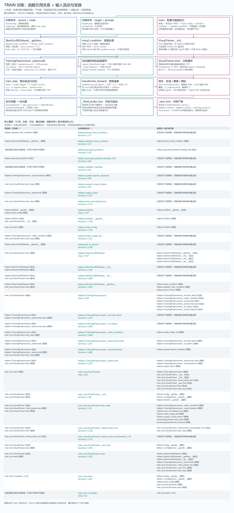

# Train：训练端

## 两个代码文件

- train_lora.py：唯一主体入口；VisualTrainer 初始化基座/LoRA/教师，负责 train_step、优化更新、固定验证和权重保存。
- helpers.py：区域转换、配置解析、数据划分与校验、损失辅助、SketchLoRADataset，以及 TrainingPreprocessor 的 VAE/文本/教师预编码。

split_manifest.json 是训练所需的数据划分，不是临时搬迁文件，保留。旧模块不保留；独立划分/校验脚本统一放在 Project/Test，不混入训练模块。

## 样本与背景

每个样本目录包含 source.png（原图）、mask.png（黑色编辑/白色保留）、target.png（目标图）、prompt.txt（指令，可缺省为空）。数据集统一到 512，将图像转换为 [-1,1] 张量。

背景输入与推理一致：visual_condition 保留 source 区域外 RGB，编辑区置灰。masked-source、source、target 分别经 VAE 编码与 2×2 打包为潜变量 tokens；文本经 CLIP/T5 编码，额外缓存空提示；区域掩码按 area 模式下采样。预编码结果缓存到 CPU。

感知监督开启时，用 mask 得到目标 ROI，经冻结 SigLIP 提取空间特征。训练期间定期将预测潜变量经冻结 VAE 解码，与目标的 SigLIP ROI 特征比较；梯度通过这些冻结网络回到预测与 LoRA，教师权重不更新。目录名称 Redux 不代表使用 Redux 背景 token。

## 主训练路径

```text
main -> 配置 -> VisualTrainer -> train
  -> 数据读取及 manifest 校验 -> TrainingPreprocessor._preencode
  -> train_step -> loss.backward -> 梯度裁剪 -> AdamW / 学习率调度
  -> _fixed_probe_loss -> 按验证损失选优 -> _save_lora
```

每步构造 clean = mask×target + (1-mask)×source，加入同一噪声得到 x_t，速度监督为 noise-clean。masked-source tokens、文字、时间和位置 ID 通过 core.processing.transformer_forward 预测速度；不是调用推理管道训练。

损失包含编辑区面积归一化 MSE、背景 MSE、编辑区重建 L1，以及可选空间感知损失。默认文字丢弃率0.1、背景权重0.05、重建权重0.05、感知权重0.5/grid4。FLUX 基座冻结，仅 LoRA 更新。

训练集更新参数；固定验证子集用于选优；测试集不参与。训练子集固定探针仅用于监测，不能当成未见样本生成效果。

## 运行

默认划分已与本端实际数据匹配，从 Project 目录执行：

```powershell
python -B OminiSketch/train/train_lora.py --name new_trial --samples 128
```

省略 --samples 使用训练分区全量样本。--split-manifest 可指定另一份匹配的现有划分，--initial-lora 可显式指定兼容暖启动权重。默认 rank16、lr=1e-4、4轮、累积1、gate0.1、文字 LoRA 开启。

当前默认划分覆盖本端 4001 例：训练 2801、验证 800、测试 400。缺失样本已从名单移除，原始数据未改动。GPU、模型和依赖前提见项目根 README。

新配置写入 train/configs/<name>.yaml，权重及 history 写入 model/skelora/<name>/，包含最佳、initial、final 和周期保存；拒绝覆盖同名实验。推理需要显式配置所选 adapter。

## 完整图



上半部分展示 source/mask/target/prompt 如何转换，下半部分覆盖 train 两个文件中的全部类、方法与匿名函数，并标出对 core 的引用。按原始尺寸放大查看；无项目内调用者的辅助定义也列出。此图不是 GPU 执行记录。


重新划分用于后续新实验。新验证/测试分区可能含旧 LoRA 训练过的样本，不能据此声称旧权重在未见样本上的效果。划分脚本、旧名单备份和校验报告统一放在 Test，运行训练/推理不依赖 Test。
